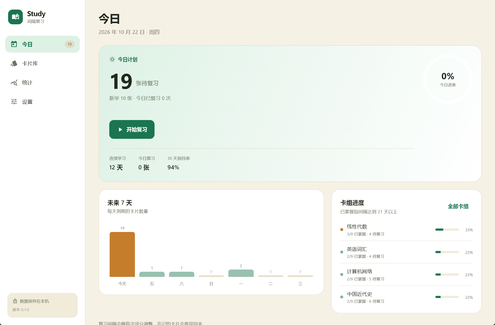
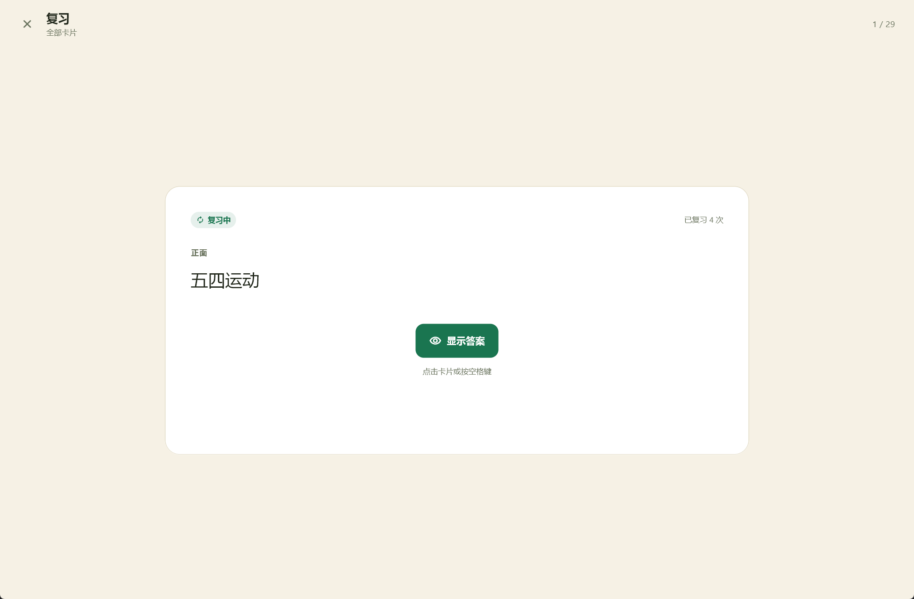
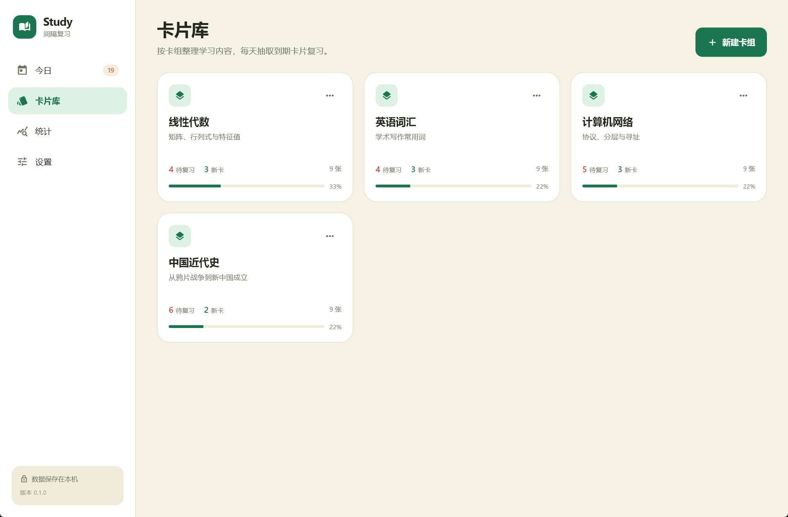
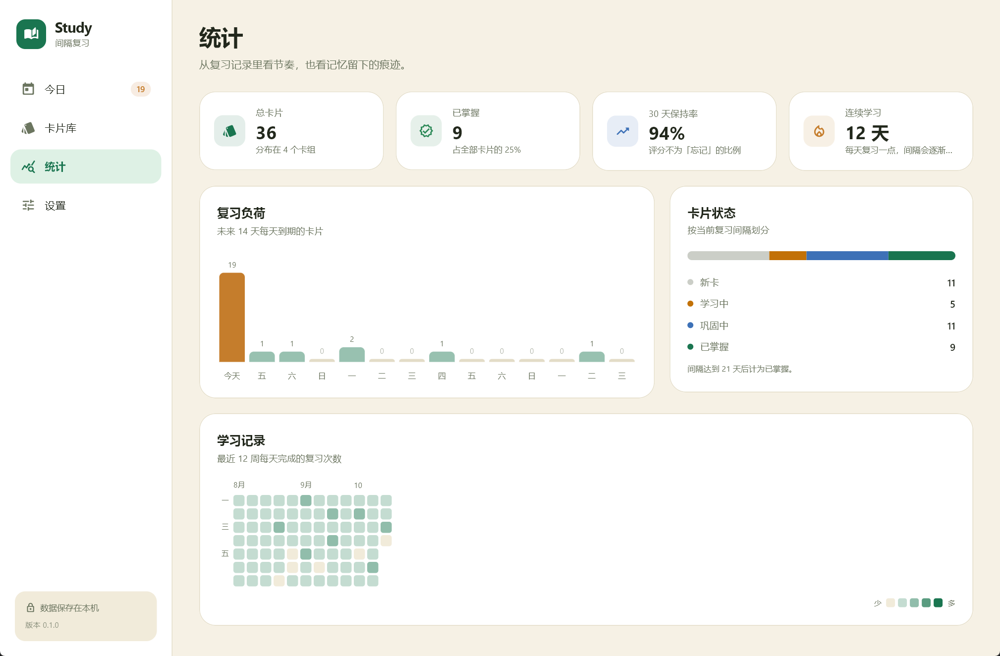

# Study

Windows 端的本地间隔复习应用，使用 Flutter 构建。把要记住的内容写成卡片，按遗忘曲线安排每天的新学与复习。



## 功能

- 卡组与卡片管理，支持搜索和按状态筛选
- 每日新卡上限，按到期时间生成当天的复习队列
- 四档评分：忘记、困难、记得、简单
- 根据评分自动调整下次复习间隔，忘记的卡片回到 1 天后
- 今日任务、连续学习天数、未来到期数量与 30 天保持率
- 14 天复习负荷、12 周学习热力图、卡片状态分布
- 浅色与深色主题，跟随系统或手动切换
- JSON 导入导出，数据保存在本机

## 复习方式

新卡第一次出现时，按「记得」会在第二天再出现一次，按「简单」则直接进入 4 天后的复习。学习中的卡片按「记得」后进入 3 天间隔，之后根据难度系数逐步拉长。复习时选择「忘记」会把间隔重置为 1 天，并降低这张卡片的难度系数。

每天的新卡数量在设置中调整，到期复习不受新卡上限影响。

## 开发

需要 Flutter 3.41 或更高版本，以及 Visual Studio 的 C++ 桌面开发组件。

```bash
flutter pub get
flutter run -d windows
```

运行测试：

```bash
flutter test
```

构建发布版本：

```bash
flutter build windows --release
```

生成的应用位于 `build/windows/x64/runner/Release/`。

## 数据

学习数据保存在 `%APPDATA%\Study\study.db`，由 SQLite 通过 Windows 自带的 `winsqlite3.dll` 访问。设置页可以查看完整路径、导出 JSON 备份或导入备份。

导出只包含卡组与卡片；导入会替换当前内容并清除复习记录，保留应用设置。

## 界面







## 许可

[MIT](LICENSE)
